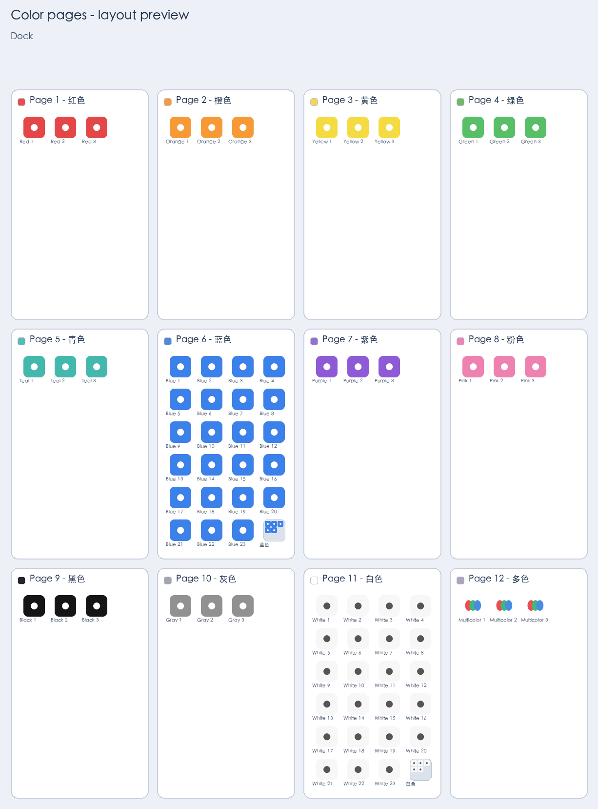

# iPhone Color Pages

Arrange an iPhone Home Screen into one page per icon color, using a Mac, a USB cable, and Apple's `cfgutil`. Review local contact sheets, correct the suggested colors, and apply a checked layout.

[简体中文](README.zh-CN.md) · [Usage](docs/usage.md) · [Safety and limitations](docs/safety-and-limitations.md)

**Read the limitations before applying.** A `cfgutil` icon-layout snapshot does not fully represent widgets or duplicate Home Screen entries. Applying a layout can require adding widgets again. Snapshots do not provide a guaranteed lossless rollback.

## Requirements

- A Mac running macOS 15.7 or later, the requirement currently listed for [Apple Configurator](https://apps.apple.com/us/app/apple-configurator/id1037126344?mt=12).
- Apple Configurator and its `cfgutil` command-line tool. This workflow was developed with version 2.21.
- An iPhone connected over USB, unlocked, and trusted by the Mac.
- Python 3.10 or later. Pillow is installed as a project dependency.

Install Apple Configurator from the Mac App Store. The CLI automatically finds the bundled `/Applications/Apple Configurator.app/Contents/MacOS/cfgutil`; installing automation tools into your `PATH` is optional. Check it with `"/Applications/Apple Configurator.app/Contents/MacOS/cfgutil" version`. If needed, put the global `--cfgutil /path/to/cfgutil` option **before** the subcommand. Follow Apple's [Home Screen layout guide](https://support.apple.com/guide/apple-configurator-mac/cadbf9c2a0/mac) for the underlying Configurator feature.

The underlying `cfgutil` method had **one real-device trial on iOS 27.0.1**. The reusable CLI in this repository has only synthetic and mocked-device tests; it has not itself been validated on a real phone. Neither is a compatibility claim for other devices or iOS versions.

## Install and preview

```sh
git clone https://github.com/wzxsph/iphone-color-pages.git
cd iphone-color-pages
python3 -m venv .venv
source .venv/bin/activate
python -m pip install -e .

# Synthetic icons only; no connected device is needed.
iphone-color-pages demo --output .local/demo
```

The module entry point is equivalent: `python -m iphone_color_pages …`.



This preview uses synthetic icons and data, not a phone screenshot.

## Use with a phone

Replace `<ECID>` with the identifier printed by `devices`. `scan` requires a new, empty session directory. Keep all session files under `.local/`, which is intended for private, untracked data.

```sh
python -m iphone_color_pages devices
python -m iphone_color_pages scan --ecid <ECID> --session .local/my-phone
python -m iphone_color_pages plan --session .local/my-phone
```

Review `preview.png`, `contact-sheets/icons-001.png` and subsequent sheets, `plan.json`, and `scan-report.json` in the session. The first pass uses local HSV image analysis: it is a rough suggestion, and white, dark, gradient, or multicolor icons often need human review. Missing or unreadable icon images and web clips default to `multicolor`; review warnings do not by themselves block `apply`. Supply a JSON object keyed by bundle identifier to override colors:

```json
{
  "com.example.reader": "blue",
  "com.example.notes": "white"
}
```

```sh
python -m iphone_color_pages plan --session .local/my-phone --overrides .local/overrides.json
python -m iphone_color_pages apply --session .local/my-phone --accept-widget-changes
python -m iphone_color_pages verify --session .local/my-phone
```

`apply` asks for confirmation in a terminal, showing the actual device and entry counts. Explicit `--yes` is required to apply without an interactive terminal; it does not replace `--accept-widget-changes` or bypass validation.

`devices`, `scan`, `snapshot`, `plan`, `verify`, and `demo` do not write a Home Screen layout to the phone. **`apply` is the only command that writes a layout.** It reads the device again and refuses a stale baseline before writing, saves before/after snapshots, and checks app-entry counts, the Dock, folders, and pages after the write. If the phone already matches the plan, it verifies without writing. It does not automatically retry or restore a layout after failure.

## How pages work

The palette is `red`, `orange`, `yellow`, `green`, `teal`, `blue`, `purple`, `pink`, `black`, `gray`, `white`, and `multicolor`. Each used color gets its own Home Screen page. Overflow goes into folders of the same color, with nine icons per folder page. The Dock is kept unchanged. `plan --page-capacity` defaults to 24 visible slots; use, for example, `--page-capacity 20` for a smaller screen layout and review the regenerated preview.

In the real-device trial, iOS inserted extra apps from the App Library after a layout write. Verification treats unexpected entries as a failure. The recovery workflow is a deliberate new snapshot and plan, followed by review and a fresh apply; see [the replan instructions](docs/usage.md#when-verification-fails).

## Local data and development

Classification runs locally with Python and Pillow. No OpenAI API, AI service, API key, cloud upload, or telemetry is used. Installing Python dependencies may access the package index.

The original one-device arrangement used AI-assisted visual classification and manual correction. This open-source CLI uses HSV suggestions and manual overrides instead; it does not automatically reproduce those visual judgments.

The public repository contains synthetic examples only. Device identifiers, app inventories, exported icons, snapshots, and generated contact sheets are private user data; do not commit them. App icons remain the property of their respective rights holders.

Run the local test suite with:

```sh
python -m unittest discover -s tests
```

See [CONTRIBUTING.md](CONTRIBUTING.md). Project code is released under the [MIT License](LICENSE). This project is independent of Apple.
